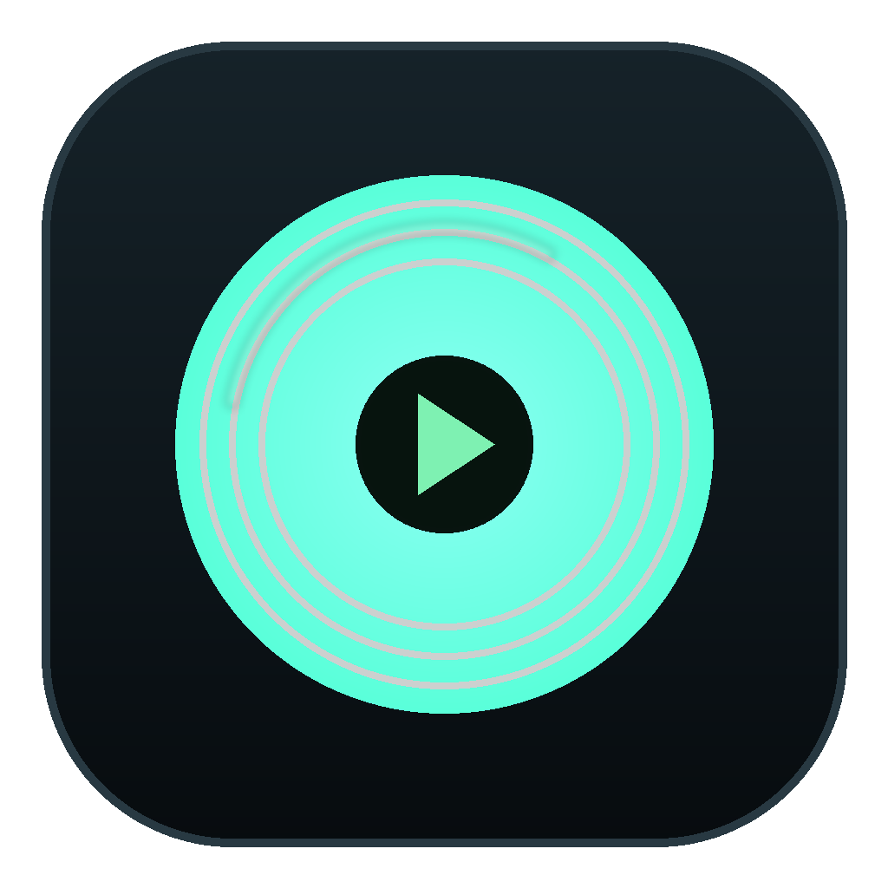
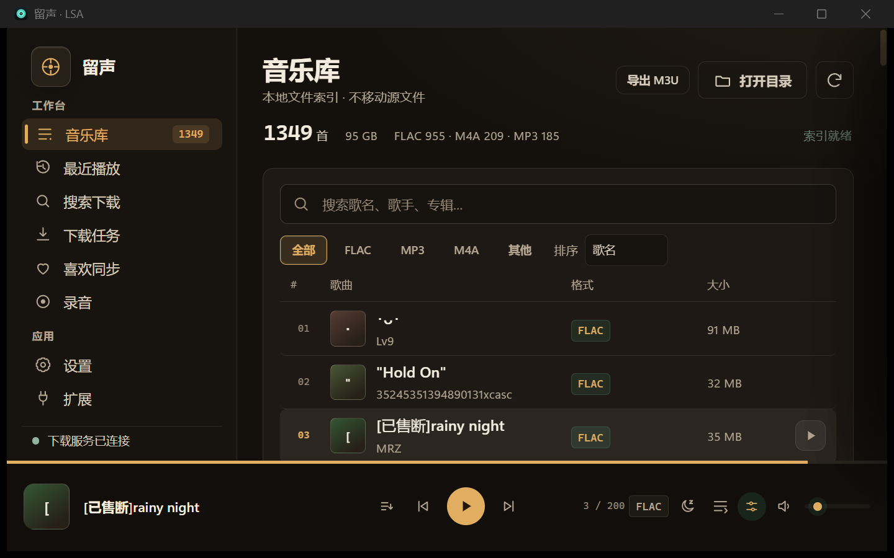
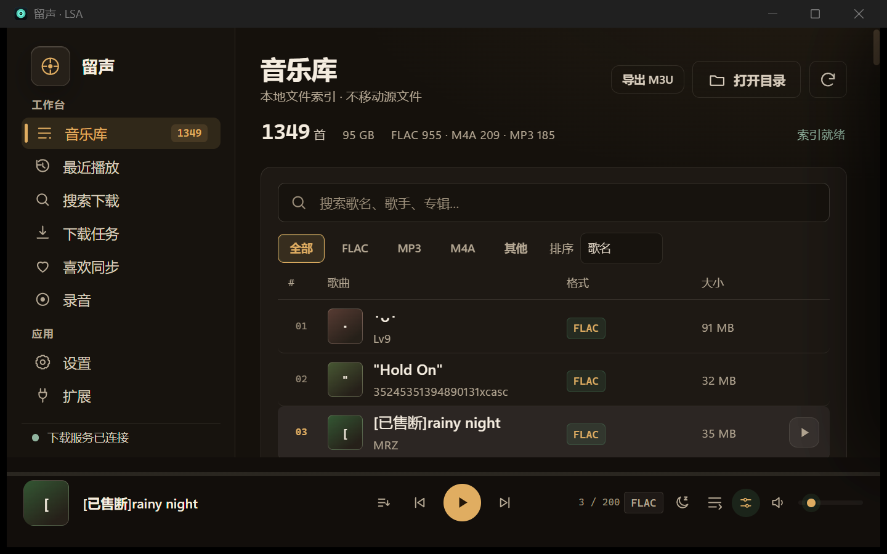
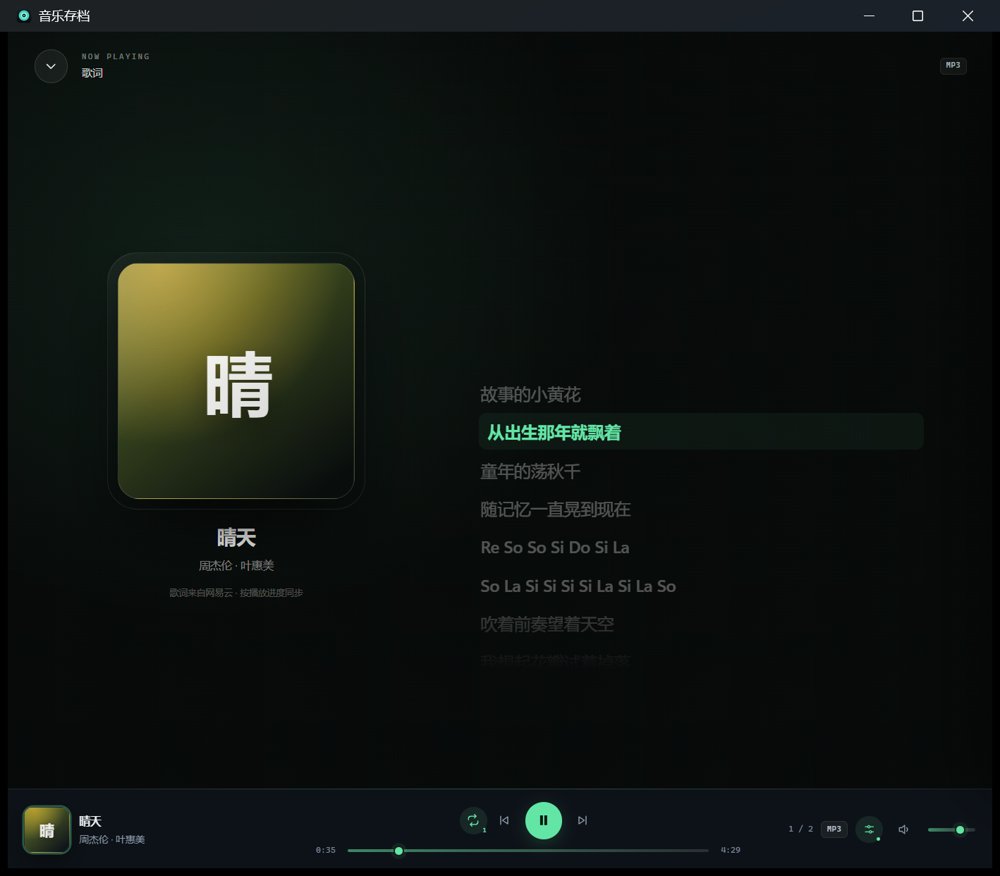
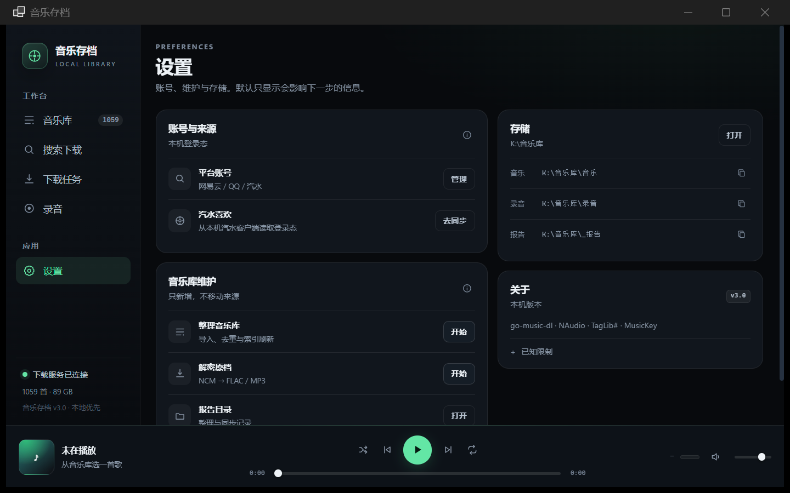

<p align="center">
  
</p>

# LSA — Local Sound Archive

<p>
  <a href="LICENSE"></a>
  
  
  
</p>

A local-first desktop music archive and player for Windows.

LSA keeps one local library across multiple music sources, plays the files you
already own, and gives you a real desktop interface instead of a browser wrapper.
The Chinese product name is **留声**.



## What it does

- **One local library** — indexes FLAC, MP3, M4A and other local files.
- **Playback** — queue, repeat/shuffle, seek, volume, sleep timer and a 10-band
  equalizer with bass, treble, stereo width and a limiter.
- **Lyrics** — immersive lyrics panel, local `.lrc`, translation and timing.
- **Likes and imports** — sync liked songs from supported sources, import local
  music, deduplicate and keep source files untouched.
- **Archive maintenance** — incremental indexing, duplicate detection, reports,
  and optional Windows Recycle Bin cleanup for removed duplicates.
- **Extensions** — a versioned extension protocol with health checks, disable,
  rollback and safe mode.
- **AI control** — a local MCP bridge for playback and library queries. See
  [AI control](#ai-control).

## Screenshots

| Player | Lyrics |
|---|---|
|  |  |

| Settings | Themes |
|---|---|
|  | Built-in vinyl, paper, celadon, ocean and cherry themes. |

## Requirements

- Windows 11 (x64)
- [.NET 10 SDK](https://dotnet.microsoft.com/download)
- [Microsoft Edge WebView2 Runtime](https://developer.microsoft.com/microsoft-edge/webview2/)
- Node.js 22+ (only for fetching build dependencies and running the MCP bridge)
- Optional: a local [`go-music-dl`](https://github.com/gaoyifan/go-music-dl) backend
  on `127.0.0.1:18088` for online search, login and download features

The local library and player work without the online backend. Cookies and account
state are stored on the local machine and are never uploaded by LSA.

## Build

```powershell
git clone https://github.com/yrui-ql/local-sound-archive.git
cd local-sound-archive

node scripts/fetch-deps.mjs
dotnet build MusicArchiveClient.csproj -c Release
```

Run:

```powershell
dotnet run --project MusicArchiveClient.csproj -c Release
```

The built executable is:

```text
bin/Release/net10.0-windows/LSA.exe
```

`scripts/fetch-deps.mjs` downloads the NuGet packages used by the Windows
client into `lib/`. No third-party binaries are committed to this repository.

### Optional backend

Online search, login and download are provided by `go-music-dl`. Start it
separately:

```powershell
go-music-dl web --port 18088 --no-browser
```

LSA connects to the backend on localhost only.

## Project layout

```text
.
├─ MainForm.cs                 WinForms shell and UI bridge
├─ AppPaths.cs                 local paths and portable config
├─ BackendService.cs           local backend process and account API
├─ LibraryService.cs           local index, import and maintenance
├─ RecordingService.cs         recording workflow
├─ ExtensionService.cs         extension host and versioned installs
├─ AiControlService.cs         local AI control API
├─ ui/                         HTML/CSS/JS interface loaded by WebView2
├─ extension-sdk/              extension manifest, protocol and sample
├─ ai-control/                 MCP bridge and AI control docs
├─ lib/                        generated dependencies (gitignored)
└─ scripts/fetch-deps.mjs      dependency fetcher
```

The UI is local HTML/CSS/JS rendered inside WebView2. There is no remote page,
localhost web app, or hidden browser window.

## AI control

LSA exposes a **local-only** MCP bridge. Open:

```text
Settings → AI Control → Enable
```

Then copy the generated MCP configuration into an MCP-capable client. The
server binds to `127.0.0.1` and requires a token stored in the local
`ai-control.json` file.

Available tools:

- `music_status`
- `music_search`
- `music_play`
- `music_pause`
- `music_resume`
- `music_next`
- `music_previous`
- `music_seek`
- `music_volume`
- `music_queue`

The AI interface can control playback and read the local library. It cannot
delete music, modify the archive database, organize files, or execute system
commands.

## Privacy

- No account cookies, tokens or music files are included in this repository.
- LSA does not upload your library, listening history or credentials.
- The AI control token lives only in the local data directory.
- Logs are local and never sent to a remote service.

## Status

This is a working Windows desktop client. Some planned integrations are not
finished yet:

- external connector search/download bridge;
- complete translations for every UI surface;
- album/artist detail pages, playlists, mini player and desktop lyrics;
- tag editing and advanced duplicate management.

The extension and AI control protocols are documented and usable, but external
connectors are still opt-in and may require manual installation.

## Development

```powershell
node scripts/fetch-deps.mjs
dotnet build MusicArchiveClient.csproj -c Release
```

Do not commit local data, `ai-control.json`, cookies, logs or built binaries.

---

MIT licensed. See [LICENSE](LICENSE). Third-party dependencies and their
licenses are listed in [THIRD_PARTY_NOTICES.md](THIRD_PARTY_NOTICES.md).

